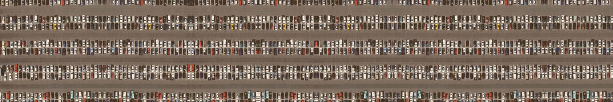

This project started because I wanted to code a transformer from scratch using PyTorch. Instead of simply copying a tutorial or re-implementing [nanoGPT](https://github.com/karpathy/nanoGPT) or similar, I wanted to try something else. So instead of embedding discrete tokens, I wanted to feed pixels directly into the model.

Training then happens with standard MSE loss where the output is interpreted as pixels as well, which then produces images with a fixed height but theoretically unlimited width. Hence the "pattern roller" analogy where we can "roll" the trained input image indefinitely. The model is just trained on one image to reproduce it as efficiently as possible. Since we just train only a single image, efficiency here meant parameter count/model size.

To generate the training data, the input image was pre-processed to stitch together the image and its horizontally flipped copy and the model was trained to reconstruct the next column of pixels as discussed already. 

Let's get one thing out of the way: **this is utterly useless!**

Unless... the model size is smaller than the single image it has been trained from. Which - spoiler alert - was not the case. So you would always be better off to just cut and flip the original image.

Everything started with a "hand-written" transformer with attention written in PyTorch as well. I then applied several architecture and training optimizations to increase parameter efficiency. This part started 1+ year later and was LLM-assisted.

After the optimization the model has 230,272 parameters. Assuming `fp8` (assuming almost no loss in performance) the model weights are around 230kB. This is around 60% larger than a PNG of the input and around 500% larger than a JPEG image.

Reducing the parameter count further might be a fun project for future me. The goal should then be to at least beat the PNG file size. For now these are the optimizations that landed here:

1. input/output embedding weight tying [@press2017usingoutputembeddingimprove] in [`model/embedding.py:104–115`](https://github.com/meffmadd/transformers/blob/main/model/embedding.py#L104-L115), [`model/transformer.py:226–233`](https://github.com/meffmadd/transformers/blob/main/model/transformer.py#L226-L233)
2. reusing a single transformer block for all layers with sinusoidal step encodings [@dehghani2019universaltransformers] in [`model/transformer.py:217–220`](https://github.com/meffmadd/transformers/blob/main/model/transformer.py#L217-L220)
3. fused SwiGLU FFN layers [@shazeer2020gluvariantsimprovetransformer] in [`model/transformer.py:16–36`](https://github.com/meffmadd/transformers/blob/main/model/transformer.py#L16-L36)
4. multi-query attention (MQA) [@shazeer2019fasttransformerdecodingwritehead] in [`model/attention.py:40–81`](https://github.com/meffmadd/transformers/blob/main/model/attention.py#L40-L81)
5. use `AdamW` with weight decay of 0.01 [@loshchilov2019decoupledweightdecayregularization] in [`model/transformer.py:170–189`](https://github.com/meffmadd/transformers/blob/main/model/transformer.py#L170-L189)
6. cosine decay of learning rate to 10% after 5% epochs warmup [@loshchilov2017sgdrstochasticgradientdescent] in [`model/transformer.py:188–212`](https://github.com/meffmadd/transformers/blob/main/model/transformer.py#L188-L212)

